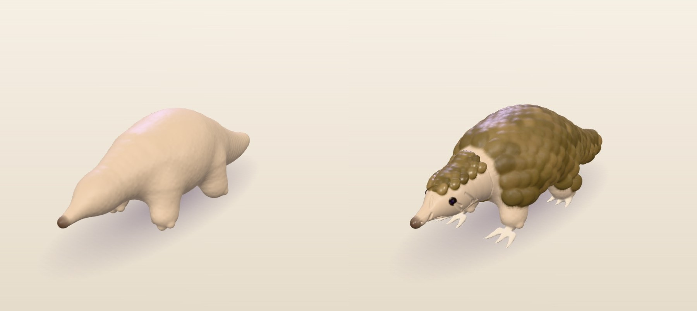
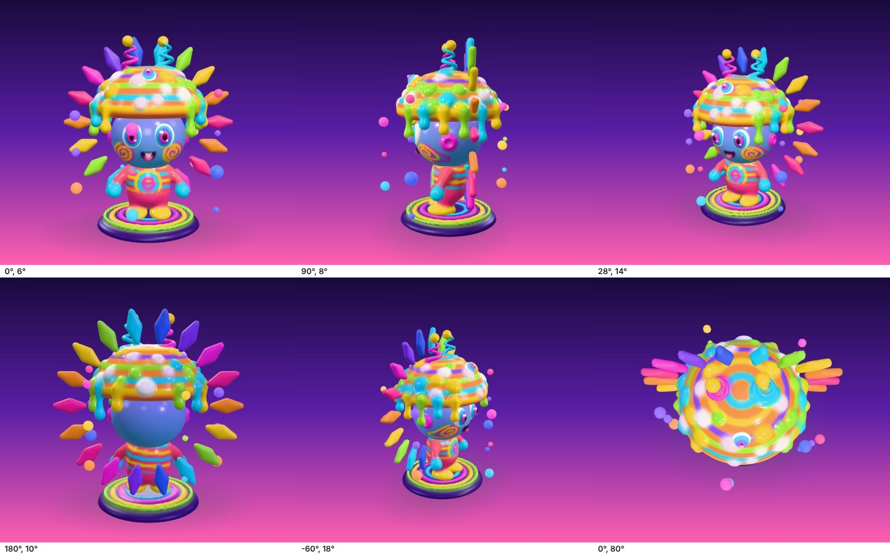
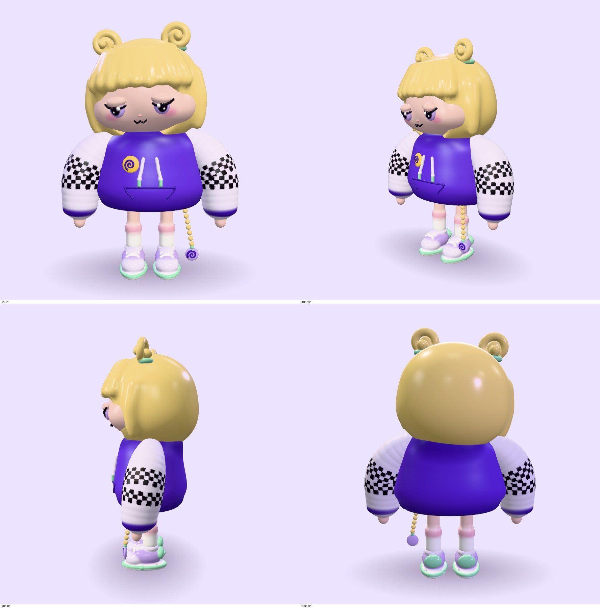

# Clayground MCP

An MCP server that lets an AI agent sculpt 3D clay in the [Clayground](https://www.clayvr.com/sculpt) browser studio. It opens the studio in a browser it controls, gives the agent tools to change the clay and look at it, and saves pictures and exports to a folder on your computer. Nothing is uploaded: the clay stays in that browser.







All three were sculpted by an agent through these tools. The scripts that did it are in [examples/](examples/).

Everything an agent makes is marked `madeWith: "agent"` in the saved file. The door cannot publish to the gallery, mint anything or sign in. Clayground's gallery is for work made by hand; this is a separate door for developers and agent builders.

## Set up

You need Node 20 or newer and either Google Chrome or Chromium (`npx playwright install chromium`).

Claude Code:

```
claude mcp add clayground -- npx -y github:helloama/clayground-MCP
```

Claude Desktop, Cursor and other clients take the same command in their MCP settings:

```json
{
  "mcpServers": {
    "clayground": {
      "command": "npx",
      "args": ["-y", "github:helloama/clayground-MCP"]
    }
  }
}
```

Then ask: "Read the sculpt manual, then sculpt a pangolin. Block out the big forms, look from several angles after every step, run the critic, and keep a checkpoint before each big change."

Options, added after the package name:

| Option                | What it does                                                                                   |
| --------------------- | ---------------------------------------------------------------------------------------------- |
| `--headed`            | Shows the browser window, so you can watch the sculpt grow.                                    |
| `--cdp <endpoint>`    | Drives your own Chrome, started with `--remote-debugging-port=9222` (`http://127.0.0.1:9222`). |
| `--out <folder>`      | Where pictures and exports go. Default `~/clayground-agent`.                                   |
| `--url <studio url>`  | The studio page. Default `https://www.clayvr.com/sculpt`. Use your own dev server to test.     |
| `--width`, `--height` | The window size. Default 1280 by 900.                                                          |

The same settings can come from the environment as `CLAYGROUND_URL`, `CLAYGROUND_CDP` and `CLAYGROUND_OUT`.

## Tools

| Tool                | What it does                                                                                                        |
| ------------------- | ------------------------------------------------------------------------------------------------------------------- |
| `sculpt_manual`     | The manual, by topic (`card`, `shape`, `sweep`, `layer`, `detail`, `seeing`, `recipes`, `limits`, `all`).           |
| `sculpt_recipes`    | Lists the recipes (vase, mug, planter, fella), or shows one with every setting's range, unit and default.           |
| `sculpt_state`      | Layers, camera, triangles, undo depth.                                                                              |
| `sculpt_do`         | Run ops, then optionally look, in one call. A refused op names the field and the allowed range and changes nothing. |
| `sculpt_look`       | Pictures of the clay as color, normals, depth, layers or silhouette, from any views, or closed in on a spot.        |
| `sculpt_critique`   | Reads the surface: how much of the clay shows form at this scale, the biggest smooth stretches, and a heat map.     |
| `sculpt_check`      | Will it print? PASS or FAIL for each question a slicer asks, with one fix and a place for each FAIL.                |
| `sculpt_compare`    | Scores the silhouette against a picture and draws where it differs.                                                 |
| `sculpt_checkpoint` | Keep, list or restore a named copy of the whole sculpt.                                                             |
| `sculpt_status`     | The notebook: goal, what was done, what is left to check. After a restart, `resume: true` rebuilds the sculpt.      |
| `sculpt_script`     | Run your own code in the page, with `clayground` in scope.                                                          |
| `sculpt_export`     | GLB, OBJ, STL, PNG or `.clayweb` into the output folder.                                                            |

What the ops can do, in short: one `texture` op lays hundreds of marks (scales, plates, studs, fur, wrinkles, pores) as a single undo step. `array` repeats a shape along a ring, a line, a path or over the skin. `loft` stretches fins, petals and ears. `refine` moves one part of a model to a finer layer so it can take two to four times the detail. `surface` and `nearest` tell the agent where the skin is without a picture. The whole manual is plain text at [clayvr.com/llms-full.txt](https://www.clayvr.com/llms-full.txt).

## Recipes, the print check and the notebook

These three are for small models, short contexts and anyone who wants a good first result without writing geometry.

A recipe is one op that builds a whole object from a few numbers: `{ "do": "recipe", "name": "mug", "height": 0.8 }`. Every setting has a range, a unit and a default, a wrong one is refused with the allowed range, and the object is made of ordinary ops, so the agent can look at it and keep going by hand. Each recipe's defaults and examples are built in the tests and pass the print check.

`sculpt_check` asks what a slicer would. Is the surface closed. Is it one body. Are there sealed hollows. Does it stand. Is there a flat first layer. Is any part thinner than 1.2 mm. Does too much hang out over nothing. Each question comes back as `PASS` or `FAIL`, and each `FAIL` says what to change and where.

Every answer ends with a `Next:` line, one thing to try, worked out from what has been done since the last look, critique and check. An agent with no plan of its own can follow it.

The notebook is `journal.json` in the output folder. It keeps the goal and every change that worked, in order, and it is rewritten after each one. If the bridge restarts, the new browser has no clay; the first answer says a saved run is waiting, and `sculpt_status` with `resume: true` rebuilds it. Use one output folder (`--out`) for each agent.

The studio opens with a ball of clay. The bridge clears it before the first op (it says so), so a mug starts from nothing; send `{ "do": "new", "detail": 64 }` yourself to choose how fine the clay is.

## Without an MCP client

An agent that already has a browser tool (Claude in Chrome, Playwright) needs none of this. Open [clayvr.com/sculpt](https://www.clayvr.com/sculpt), run `clayground.help()` in the page and follow it. `window.clayground` is the same door these tools use.

To run an example on its own:

```
git clone https://github.com/helloama/clayground-MCP
cd clayground-MCP
npm install
node examples/pangolin.mjs
```

Pictures land in `~/clayground-agent` (or `CLAYGROUND_OUT`). `examples/psychedelic-toy.mjs` builds the toy and `examples/designer-figure.mjs` builds the figure (eyes with half lids, a bob with coil buns, checkered sleeves, sneakers); each takes several minutes, and `STOP=2` stops after the second stage.

## Limits

- About 128 MB of clay in the browser: a 128-voxel layer is about 15 MB. 12 layers, about 40 undo steps, six checkpoints.
- Up to 2000 marks in one texture or array op. Marks thinner than about 1.2 voxels disappear; a finer layer fixes that.
- Render passes need WebGL. On a computer with no graphics card the studio draws in software, and an op takes seconds, not milliseconds.
- The critic reads surface detail (smooth stretches, thin spots). Whether the model looks like what it should is the agent's judgment of the pictures.

## Where the code comes from

This repository is a copy of the bridge from the Clayground project, published so anyone can run it. The studio it drives is the live site.
